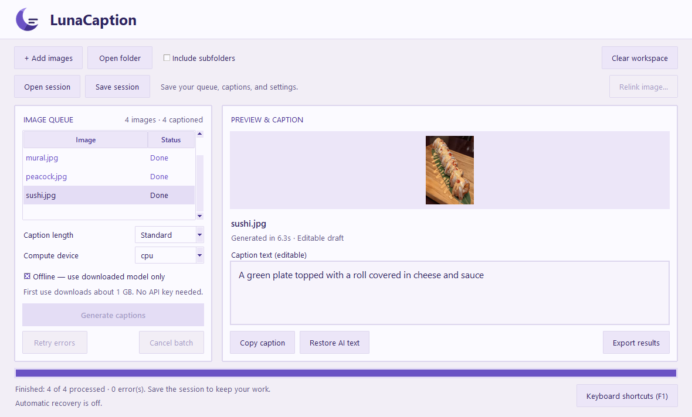
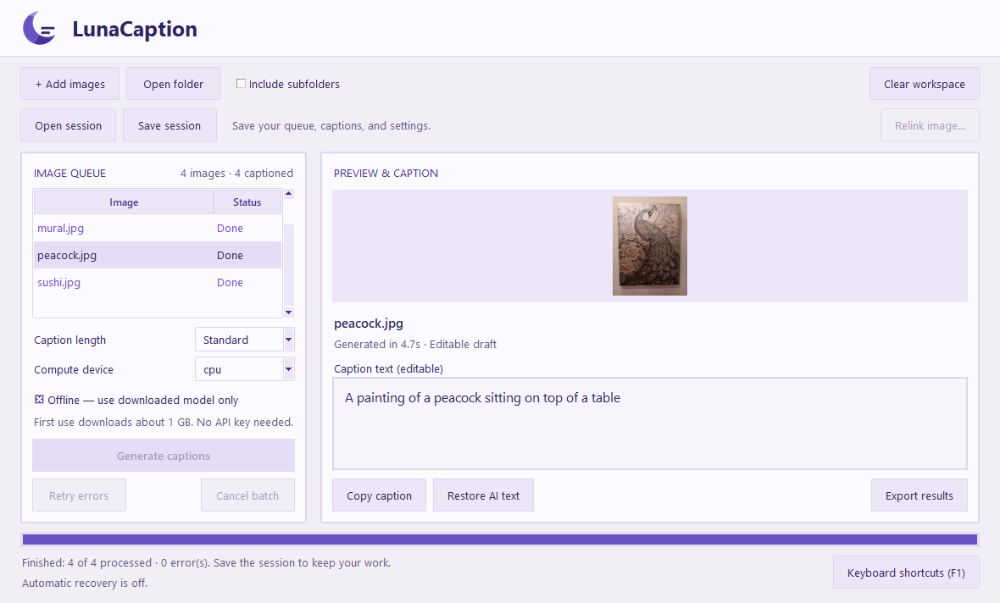

  

LunaCaption is a Windows desktop app that writes captions for a batch of photos on your own computer. Review and edit each caption, then export them all to CSV or JSON.

It runs the pretrained [Salesforce BLIP](https://huggingface.co/Salesforce/blip-image-captioning-base) model locally, so your images are never uploaded, and it works offline after a one-time 1 GB model download.

## Features

- Caption single images or whole folders
- Short, standard, or long captions
- Edit, copy, or restore any caption
- Save and reopen sessions, with automatic crash recovery
- Export to CSV or JSON
- Runs on CPU, with optional CUDA
- Full keyboard control (press F1)

## Getting started

You need Windows 10/11 (64-bit) and Python 3.11–3.13 with Tcl/Tk. Open PowerShell in this folder and run:

~~~powershell
.\Setup-Windows.ps1 -DownloadModel
~~~

Then double-click **Launch-LunaCaption.cmd**.

If setup can't find Python, add `-PythonExe "C:\Path\To\python.exe"`.

## Command line

~~~powershell
.\Launch-LunaCaption.cmd "C:\Photos" --output captions.csv
.\Launch-LunaCaption.cmd "C:\Photos" --recursive --offline --length Long --output captions.json
.\Launch-LunaCaption.cmd --diagnose
~~~

## Good to know

- BLIP can miss details or get things wrong, so check captions before using them as alt text.
- On a 50-image Flickr8k sample it scored BLEU-4 21.46 and ROUGE-L 47.21 ([details](docs/EVALUATION.md)).
- More docs: [sessions](docs/SESSIONS.md) · [keyboard](docs/KEYBOARD.md) · [GPU](docs/DEVICES.md) · [building an .exe](docs/PACKAGING.md)

## Development

~~~powershell
.\Setup-Windows.ps1 -Dev
.\.venv\Scripts\python.exe -m pytest -q
.\.venv\Scripts\python.exe -m ruff check src tests scripts
~~~

## License

MIT for LunaCaption's code. BLIP and other dependencies keep their own licenses; see [third-party notices](THIRD_PARTY_NOTICES.md).
